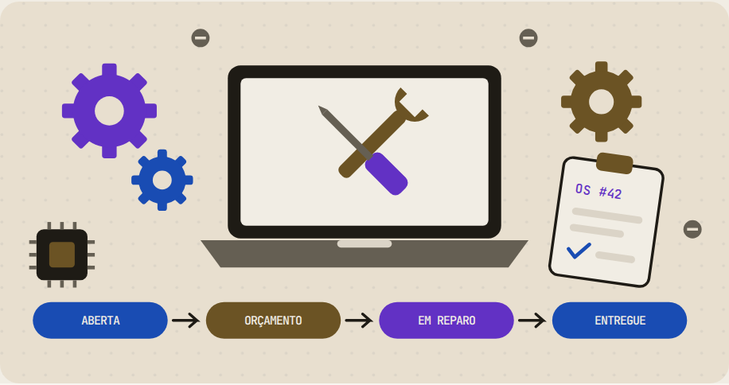
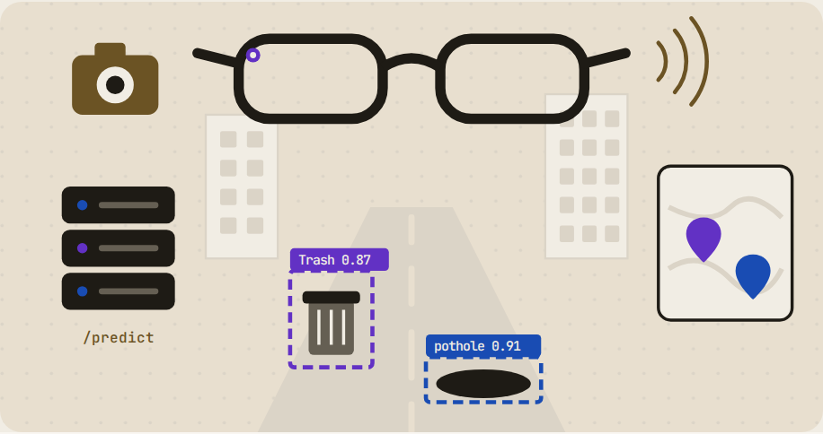

<!-- Cabeçalho animado -->
<p align="center">
  
</p>

<p align="center">
  <a href="https://marciodev.com">
    
  </a>
</p>

<p align="center">
  <a href="https://marciodev.com"></a>
  <a href="https://marciodev.com/curriculo-pt.pdf"></a>
  <a href="https://marciodev.com/curriculo-en.pdf"></a>
  <a href="https://www.linkedin.com/in/marcioflima/"></a>
  <a href="mailto:contactmarcioflima@gmail.com"></a>
</p>


## 👨‍💻 Sobre mim

```yaml
nome: Márcio Ferreira Lima
local: Surubim, PE 🇧🇷
trabalho: Técnico de Informática @ Universidade de Pernambuco (DTIC-Infra)
estudo: Engenharia de Software @ UPE · 5º período
bolsa: Inovação Tecnológica · Observatório UPE (PROPEGI)
interesses: [Backend, DevOps, Infraestrutura]
no dia a dia:
  - mantenho a rede do campus: firewall Fortinet, switch Aruba, APs Ruckus, cabeamento UTP
  - construo APIs em Java + Spring Boot com testes e deploy automatizado
  - coloco projetos no ar com Docker, GitHub Actions e Cloudflare
procurando: estágio em Backend, DevOps ou Infraestrutura
```

## 🛠️ Stack

<table>
  <tr>
    <td align="center" width="140"><b>Backend</b></td>
    <td>
      <picture>
        <source media="(prefers-color-scheme: dark)" srcset="https://skillicons.dev/icons?i=java%2Cspring%2Cpython%2Cpostgres&theme=dark" />
        
      </picture>
    </td>
  </tr>
  <tr>
    <td align="center"><b>DevOps &amp; nuvem</b></td>
    <td>
      <picture>
        <source media="(prefers-color-scheme: dark)" srcset="https://skillicons.dev/icons?i=docker%2Cgithubactions%2Clinux%2Cbash%2Ccloudflare%2Cgit&theme=dark" />
        
      </picture>
    </td>
  </tr>
  <tr>
    <td align="center"><b>Redes</b></td>
    <td>
      
      
      
      
      
      
    </td>
  </tr>
  <tr>
    <td align="center"><b>Também uso</b></td>
    <td>
      <picture>
        <source media="(prefers-color-scheme: dark)" srcset="https://skillicons.dev/icons?i=flutter%2Ckotlin%2Castro%2Cts&theme=dark" />
        
      </picture>
    </td>
  </tr>
</table>

## 🚀 Projetos em destaque

<table>
  <tr>
    <td width="50%" valign="top">
      <a href="https://marciodev.com/projetos/clinics">
        <picture>
          <source media="(prefers-color-scheme: dark)" srcset="assets/clinics-dark.png" />
          
        </picture>
      </a>
      <h3><a href="https://marciodev.com/projetos/clinics">Clinics</a></h3>
      Comparador de preços de exames em Surubim-PE: API hexagonal com <b>154 testes</b>, CI/CD e deploy numa VPS Oracle atrás de Cloudflare Tunnel, mais app em Flutter.
      <br /><br />
      <code>Spring Boot</code> <code>PostgreSQL</code> <code>Flutter</code> <code>Docker</code> <code>CI/CD</code>
      <br /><br />
      <a href="https://github.com/MarcioFerreiraL/clinics-backend">API</a> · <a href="https://github.com/MarcioFerreiraL/clinics-mobile">App</a> · <a href="https://clinics.marciodev.com">Demo</a>
    </td>
    <td width="50%" valign="top">
      <a href="https://marciodev.com/projetos/barbearia">
        <picture>
          <source media="(prefers-color-scheme: dark)" srcset="assets/barbearia-dark.png" />
          
        </picture>
      </a>
      <h3><a href="https://marciodev.com/projetos/barbearia">Sistema Barbearia</a></h3>
      Agendamento online com autenticação JWT, controle de acesso por papel e validação de conflito de horários; imagem no GHCR e deploy por GitHub Actions.
      <br /><br />
      <code>Spring Boot</code> <code>JWT</code> <code>Next.js</code> <code>Docker</code> <code>GitHub Actions</code>
      <br /><br />
      <a href="https://github.com/MarcioFerreiraL/sistema-barbearia">Código</a> · <a href="https://sistema-barbearia-black.vercel.app">Demo</a>
    </td>
  </tr>
  <tr>
    <td width="50%" valign="top">
      <a href="https://marciodev.com/projetos/assistencia-tecnica">
        <picture>
          <source media="(prefers-color-scheme: dark)" srcset="assets/assistencia-tecnica-dark.png" />
          
        </picture>
      </a>
      <h3><a href="https://marciodev.com/projetos/assistencia-tecnica">Assistência Técnica</a></h3>
      Ordens de serviço com máquina de estados (padrão State) e roteiro de reparo com Template Method, para quatro perfis de usuário.
      <br /><br />
      <code>Spring Boot</code> <code>Vue.js</code> <code>PostgreSQL</code> <code>Padrões GoF</code>
      <br /><br />
      <a href="https://github.com/MarcioFerreiraL/sistema-assistencia-tecnica">Código</a>
    </td>
    <td width="50%" valign="top">
      <a href="https://marciodev.com/projetos/urbansense">
        <picture>
          <source media="(prefers-color-scheme: dark)" srcset="assets/urbansense-dark.png" />
          
        </picture>
      </a>
      <h3><a href="https://marciodev.com/projetos/urbansense">UrbanSense</a></h3>
      App Android para os óculos Meta Ray-Ban que detecta lixo e buracos na rua com YOLO11 numa API remota. Projeto em equipe.
      <br /><br />
      <code>Kotlin</code> <code>Android</code> <code>YOLO11</code> <code>Docker</code>
      <br /><br />
      <a href="https://github.com/MarcioFerreiraL/urbansense-app">Código</a> · <a href="https://github.com/MarcioFerreiraL/urbansense-app/releases/tag/apks-v1.0.5">APKs</a>
    </td>
  </tr>
  <tr>
    <td colspan="2" align="center">
      <picture>
        <source media="(prefers-color-scheme: dark)" srcset="assets/observatorio-upe-dark.png" />
        
      </picture>
      <h3>🔒 Observatório UPE <sub><code>em construção</code></sub></h3>
      Centralizando dados dos departamentos da Universidade de Pernambuco. Projeto da PROPEGI · mais detalhes em breve.
    </td>
  </tr>
</table>

<p align="center"><a href="https://marciodev.com/projetos"><b>Ver todos os projetos →</b></a></p>

## 📊 No GitHub

<p align="center">
  <picture>
    <source media="(prefers-color-scheme: dark)" srcset="https://github-readme-stats.vercel.app/api?username=MarcioFerreiraL&show_icons=true&hide_rank=true&hide_border=true&bg_color=15130F&title_color=B797F7&icon_color=7BA3F4&text_color=EEEAE2&locale=pt-br" />
    
  </picture>
  <picture>
    <source media="(prefers-color-scheme: dark)" srcset="https://streak-stats.demolab.com?user=MarcioFerreiraL&hide_border=true&background=15130F&ring=B797F7&fire=CAAD72&currStreakLabel=B797F7&sideLabels=EEEAE2&currStreakNum=EEEAE2&sideNums=EEEAE2&dates=B1ABA0&stroke=3A352C&locale=pt_BR" />
    
  </picture>
</p>

<p align="center">
  <picture>
    <source media="(prefers-color-scheme: dark)" srcset="https://raw.githubusercontent.com/MarcioFerreiraL/MarcioFerreiraL/output/github-snake-dark.svg" />
    
  </picture>
</p>

## 📫 Vamos conversar

Estou buscando **estágio em Backend, DevOps ou Infraestrutura**. Se quiser conversar sobre uma vaga ou um projeto, me chame por [e-mail](mailto:contactmarcioflima@gmail.com) ou no [LinkedIn](https://www.linkedin.com/in/marcioflima/).

<p align="center">
  
</p>
